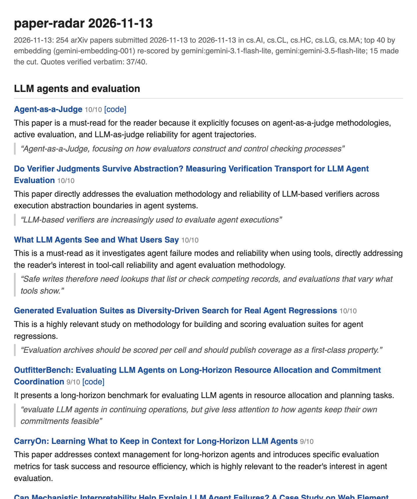

# paper-radar

A weekly arXiv digest ranked against an interest profile you write in Markdown.

## Try it

- **Read a real digest, no install:** <https://oguzhanozfe.github.io/paper-radar/>.
  - [2026-W46](https://oguzhanozfe.github.io/paper-radar/2026-W46.html) covers all 1,226 papers the
    API returned for the week. They were ranked by a local `qwen3-embedding:0.6b` prefilter, then
    re-scored by Groq `openai/gpt-oss-20b`.
  - [2026-11-13](https://oguzhanozfe.github.io/paper-radar/2026-11-13.html) covers the 254 papers
    from that day. They were ranked by `gemini-embedding-001`, then re-scored by Gemini flash-lite.

  [](https://oguzhanozfe.github.io/paper-radar/2026-W46.html)

- **Run it with no key** (Python 3.10+, standard library only):

  ```bash
  git clone https://github.com/oguzhanozfe/paper-radar && cd paper-radar
  python -m paper_radar demo        # writes demo-out/2026-11-13.md and .html
  ```

  The demo ranks the bundled day of papers ([`demo/papers-2026-11-13.jsonl`](demo/papers-2026-11-13.jsonl))
  and picks a model on its own:

  1. If `GEMINI_API_KEY` is set, it uses Gemini.
  2. Otherwise, if a local Ollama with `qwen3.5:9b` and `qwen3-embedding:0.6b` is running, it uses that.
  3. Otherwise it replays the recorded run and says so: `mode: replay (recorded gemini:…, 2026-11-17)`.

  The recording ([`demo/recorded.json`](demo/recorded.json)) holds each paper's embedding similarity
  score and the LLM's replies from the run that produced the committed digest, so replay reproduces
  that digest exactly. It finishes in under a second, and CI checks it on every push. It covers only
  the bundled papers with the bundled `profile.md`. To rank with your own profile, use a real model.
  A live Gemini run of the demo embeds 259 texts, about a quarter of the free tier's daily embedding
  quota, and takes a few minutes, because embedding batches are spaced a minute apart.
  `--mode gemini|ollama|replay` forces a lane. If a live lane fails, for example on quota, `auto`
  redoes the whole run in replay.

- **Use a real model on this week's papers:** see [Run it](#run-it).

## Why

A one-week query for cs.CL/AI/LG/MA/HC returned 1,226 papers from the API. Keyword alerts drown
you, and an unchecked LLM summary will invent supporting evidence. paper-radar keeps three things
honest:

- **Measured ranking.** The ranker is scored against a labelled sample, next to an embedding-only
  ranker and a keyword ranker built from the same profile. The table is below.
- **Grounded reasons.** The model must quote 4–15 words from the abstract. A quote that isn't found
  verbatim (after normalising whitespace, case and curly quotes) is dropped, and the reason is
  shown without it.
- **Cheap to run.** Free-tier cloud models, 8 abstracts per LLM request, and every model reply and
  embedding cached on disk by input hash, so a rerun costs no requests.

## How it works

```
arXiv API ──► week of papers ──► embedding similarity to each profile theme ──► top-k (default 64)
           (3 s between requests,                                                   │
            500 per page)                                     LLM: score 0-10, theme, reason, quote
                                                                                     │
                                       quote verified? ◄─────────────────────────────┘
                                                │
                       digest: score ≥ 7 → top N by theme · score 5-6 → "skipped but close"
```

- `paper_radar/arxiv.py` fetches papers and detects code links (GitHub URLs in the abstract or the
  arXiv comment field get a `[code]` link in the digest).
- `paper_radar/rank.py` holds the keyword baseline, the embedding ranker, and the LLM judge with
  quote verification.
- `paper_radar/models.py` holds the backends. Gemini is the default, through its OpenAI-compatible
  API. Groq, OpenRouter, DeepSeek and a local Ollama are optional.
- `paper_radar/digest.py` renders the Markdown and the inline-styled HTML. All arXiv and model text
  is escaped.
- `profile.md` is the interest profile: one `##` section per theme, embedded as-is, plus a
  `keywords:` line for the baseline. The default themes are LLM agents and evaluation, tool use and
  MCP, local and small models, RAG with evidence, and AI for games and player data.

## Run it

Python 3.10+, standard library only.

```bash
export GEMINI_API_KEY=...          # free tier: see the embedding quota note below
python -m paper_radar fetch --out data/week-pool.jsonl          # last 7 days, default categories
python -m paper_radar digest --pool data/week-pool.jsonl        # writes digests/<year>-W<week>.md/.html
```

To fetch and build in one step, omit `--pool`. Options: `--days`,
`--categories cs.CL,cs.AI`, `--top 15`, `--k 64`, `--profile my-profile.md`, `--name`.

Backends (keys are read from the environment only):

| Env var | Values | Default |
|---|---|---|
| `PAPER_RADAR_LLM` | `gemini`, `groq` (`GROQ_API_KEY`, `openai/gpt-oss-20b`), `openrouter` (`OPENROUTER_API_KEY`, Gemma `:free`), `deepseek`, `ollama` | `gemini` |
| `PAPER_RADAR_LLM_MODEL` | comma-separated fallback list | `gemini-3.5-flash-lite,gemini-3.1-flash-lite,gemma-4-31b-it` |
| `PAPER_RADAR_EMBED` | `gemini`, `ollama`, `lmstudio`, `openrouter` (`nvidia/nemotron-3.5-embed-8b:free`) | `gemini` (`gemini-embedding-001`) |
| `LMSTUDIO_HOST` | LM Studio URL, for `PAPER_RADAR_EMBED=lmstudio` / `PAPER_RADAR_LLM=lmstudio` (set `PAPER_RADAR_LLM_MODEL`) | `http://127.0.0.1:1234` (`text-embedding-nomic-embed-text-v1.5`) |
| `OLLAMA_HOST` | Ollama URL | `http://127.0.0.1:11434` (`qwen3.5:9b`, `qwen3-embedding:0.6b`) |

If a model is out of quota or overloaded, the next one in the list is tried, and every scored paper
records which model scored it.

Tests run offline, with no key or model:

```bash
python -m unittest discover -s tests -t .
```

### Scheduled digest (optional, off by default)

[`.github/workflows/weekly-digest.yml`](.github/workflows/weekly-digest.yml) builds the digest and
commits it to `digests/`, refreshing the Pages index in `docs/`. It runs only when started by hand from the Actions tab. To schedule it,
uncomment the `schedule:` block (Mondays 06:00 UTC). It needs a `GEMINI_API_KEY` repository
secret. On the free tier a full week won't fit the embedding quota, so narrow `--days` or the
categories, use a paid key, or use a self-hosted runner with Ollama (`PAPER_RADAR_EMBED=ollama`).

## Measured results

**Eval set.** 100 papers drawn uniformly at random (fixed seed) from the 1,226 papers the arXiv
API returned for submissions between 2026-11-10 and 2026-11-13 in the five default categories
([`data/eval/papers.jsonl`](data/eval/papers.jsonl)). 14 are labelled relevant to the default profile
([`data/eval/labels.csv`](data/eval/labels.csv)).

**Rankers** (all scored on the same 100):

- **Keyword baseline:** a count of the profile's `keywords:` terms in the title and abstract.
- **Embedding only:** max cosine similarity to a theme, using `gemini-embedding-001`.
- **Shipped pipeline:** embedding top-40, then LLM-scored, in batches of 8.
- **LLM on all papers:** every paper LLM-scored, as an extra row.

LLM ties are broken by embedding score, then by id.

| Ranker | P@10 | R@20 |
|---|---|---|
| keyword baseline | 0.50 | 0.43 |
| embedding only | 0.80 | 0.93 |
| embedding top-40 → LLM (shipped) | 0.80 | 0.93 |
| LLM on all papers | 0.80 | 0.86 |
| random order (expected) | 0.14 | 0.20 |

LLM scores came from `gemini-3.5-flash-lite` (76 of 100 papers) and its fallback
`gemini-3.1-flash-lite` (24 of 100), because of free-tier rate limits during the run on
2026-11-17. The digest's own cut (LLM score ≥ 7 within the top 40) kept 18 papers: precision 0.72,
recall 0.93. Quotes verified verbatim: 39/40 in the pipeline, 96/100 across all papers.

Every number here is recomputed offline from committed files by
`python -m paper_radar eval-report` ([`data/eval/report.txt`](data/eval/report.txt)), and CI runs that
command. The per-paper scores, reasons and models are in
[`data/eval/scores.json`](data/eval/scores.json).

**What this says.** Embeddings do most of the ranking work on this sample. The LLM step does not
beat embedding-only on P@10 or R@20 (0.80 and 0.93 for both). Scoring all 100 papers with the LLM is
slightly worse on recall than prefiltering first. What the LLM adds is a reason, a theme and a
verified quote for each paper, plus an absolute score: the digest can say "nothing this week" for
a theme, instead of always showing a top 10. With 14 relevant papers, one paper moves P@10 by 0.10,
so differences of that size are noise.

**The model pair behind the week digest**, scored on the same 100 papers and labels. The embedder
is `qwen3-embedding:0.6b` on a local Ollama, and the LLM is Groq `openai/gpt-oss-20b`, with
`reasoning_effort: low`. The run was on 2026-11-17.

| Ranker | P@10 | R@20 |
|---|---|---|
| embedding only (`qwen3-embedding:0.6b`) | 0.70 | 0.71 |
| embedding top-40 → LLM (`gpt-oss-20b`) | 0.70 | 0.86 |

The digest cut (score ≥ 7) kept 16 papers: precision 0.62, recall 0.71. Quotes verified verbatim:
35/40. This pair is weaker than the Gemini pair above, and here the LLM step does add recall over
its own embedder. Sources:
[`data/eval/report-qwen3emb-gptoss.txt`](data/eval/report-qwen3emb-gptoss.txt) and
[`data/eval/scores-qwen3emb-gptoss.json`](data/eval/scores-qwen3emb-gptoss.json). To recompute:
`python -m paper_radar eval-report --scores scores-qwen3emb-gptoss.json`.

**Which embedder.** These are the three embedders scored as embedding-only rankers on the same
100 papers. "Top-40 recall" is the share of relevant papers the LLM step gets to see after the
prefilter.

| Embedder | P@10 | R@20 | Top-40 recall | Source |
|---|---|---|---|---|
| `gemini-embedding-001` (Gemini API) | 0.80 | 0.93 | 1.00 | [`report.txt`](data/eval/report.txt) |
| `qwen3-embedding:0.6b` (Ollama) | 0.70 | 0.71 | 1.00 | [`report-qwen3emb-gptoss.txt`](data/eval/report-qwen3emb-gptoss.txt) |
| `text-embedding-nomic-embed-text-v1.5` (LM Studio) | 0.40 | 0.57 | 0.71 | [`report-nomic-embed.txt`](data/eval/report-nomic-embed.txt) |

nomic's prefilter would hide 4 of the 14 relevant papers from the LLM. So the week digest uses
`qwen3-embedding:0.6b`, the best embedder that fit the day's quota. Adding nomic's
`search_query:` and `search_document:` prefixes gave the same scores in a one-off check that is
not committed.

## Known limits

- **Labels.** The 100 labels were drafted by an LLM annotator (Claude Sonnet) from title and abstract
  only, then reviewed by the build agent (Claude Opus), which read the abstracts of the 17
  low-confidence items and flipped 2. No human has labelled the set yet. They were committed before
  any ranker was scored, which the git history shows. Relabelling or spot-checking by the profile's
  owner would make the numbers stronger.
- **Small sample.** 100 papers and 14 positives: treat the table as a sanity check, not a benchmark.
- **One week.** The 7-day query on 2026-11-17 returned 1,226 papers, all submitted
  2026-11-10 to 2026-11-13. Later submissions were not in the API's index yet when it ran.
- **Free-tier quotas and the two digests.** Gemini's free tier counted every embedded text as one
  request: 100 a minute and 1,000 a day per embedding model, shared by every project on the same
  key. A five-category week is about 1,230 texts. On 2026-11-17 the daily quota ran out, so the
  first committed digest covers one day (2026-11-13), embedded with `gemini-embedding-001`.
- **What happened with the week digest:**
  - **OpenRouter:** its free embedder, `nvidia/nemotron-3.5-embed-8b:free`, took about 1.5 s per
    text. It also rejected the profile's "AI for games and player data" theme with HTTP 422, "input
    rejected by content safety screening", so it can't be relied on for this profile.
  - **What was used:** the week digest (2026-W46) uses a local `qwen3-embedding:0.6b`, which took
    about 2 minutes for the week, and Groq `gpt-oss-20b` for the LLM step. That pair is measured
    above.
  - **Groq limits:** Groq's free tier allows 8,000 tokens a minute, shared across the key, so its
    429s are waited out once per minute window.
  - **Resuming:** embeddings and replies are cached, so a run that stops resumes where it stopped.
    Each result records which model scored it.
- **Code detection** only sees GitHub links in the abstract or the arXiv comment. A link that exists
  only in the PDF is missed. Abstracts that say "code will be released" without a link are flagged
  `code_hint` but not linked.
- **Ollama** was used only for embeddings, in the week digest and the second eval table. Ollama
  as the LLM (`qwen3.5:9b`) has not been run live.
- **Quote check** proves the quote exists in the abstract. It does not prove the reason is right.

## Data and terms

Paper metadata comes from the [arXiv API](https://info.arxiv.org/help/api/) and follows its
[terms of use](https://info.arxiv.org/help/api/tou.html): at most one request at a time, at least
3 seconds apart, and longer back-off on HTTP 429. Thank you to arXiv for use of its open access
interoperability. arXiv metadata is CC0. Abstracts are reproduced in `data/eval/` only for
evaluation. `fixtures/arxiv_sample.xml` is a recorded API response used by the offline tests.

## License

MIT
